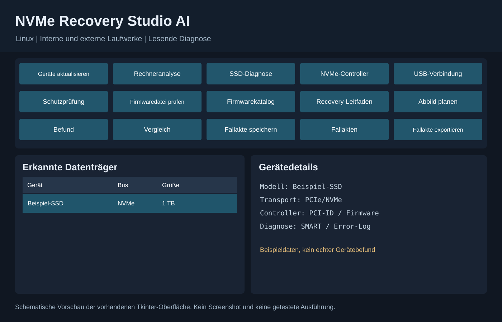

# NVMe Recovery Studio AI

KI-gestützte NVMe-Controllerdiagnose und Firmware-Wiederherstellung. **Projektstatus: erste ausführbare Desktop-Grundlage (0.1.0), noch keine funktionsfähige SSD-Recovery.**\n\n## Vorschau der Benutzeroberfläche

*Darstellung anhand der aktuellen Tkinter-Oberfläche und ihrer Schaltflächen. Die angezeigte SSD ist ein Beispiel. Dies ist kein echter Screenshot und kein Nachweis eines erfolgreichen Hardwaretests.*

**NVMe-Diagnose unter Linux:** Zusätzlich werden jetzt die Firmware-Slot-Tabelle (`nvme fw-log`) und die Namespace-Identität (`nvme id-ns`) lesend abgefragt. Diese Angaben dienen der Controlleranalyse und erlauben keine Firmware-Schreiboperationen.\n\n**Firmware-Fähigkeitsanalyse:** Das Modul `app/nvme_capabilities.py` dekodiert die NVMe-Identify-Bits `FRMW` und `OACS`, die aktive bzw. vorgemerkte Firmware-Slot-Nummer aus `AFI` sowie Namespace-Metadaten. Diese Werte sind reine Diagnosehinweise, keine Firmware-Kompatibilitäts- oder Flashfreigabe.\n\n**Begrenzte Rohdaten-Leseprobe:** Unter Linux kann nach ausdrücklicher Bestätigung ein direktes NVMe-Namespace auf maximal 4 KiB am Anfang lesend geprüft werden. Seriennummer und Kapazität werden vorher erneut abgeglichen. Es wird kein Abbild erzeugt. Ein blockierender Gerätezugriff kann derzeit nicht zuverlässig abgebrochen werden; für instabile SSDs ist die Funktion mit Vorsicht zu verwenden.\n\n**Partitionssignaturen:** Die 4-KiB-Leseprobe interpretiert jetzt vorhandene MBR-Einträge, Schutz-MBR-Hinweise auf GPT und mögliche NTFS-/exFAT-/FAT-Bootsektoren, ohne zusätzliche SSD-Lesevorgänge. Es handelt sich nur um Signaturhinweise, nicht um eine Dateisystem- oder Datenrettungsprüfung.\n\n**GPT-Header-Analyse:** Aus dem vorhandenen maximal 4 KiB großen Lesepuffer werden mögliche primäre GPT-Header erkannt. Das Programm prüft Headergröße, CRC32 und grundlegende LBA-/Partitionseintragsfelder. Die Prüfung ersetzt weder das Lesen der Backup-GPT noch die Validierung der vollständigen Partitionseintragstabelle. Bei 4-KiB-Logiksektoren liegt LBA 1 außerhalb der Probe.\n\n**GPT-Partitionseinträge:** Bereits gelesene GPT-Einträge werden bis zu 16 vollständigen Einträgen als begrenzte Vorschau ausgewertet (Typ-GUID-Rohbytes und LBA-Grenzen). Die CRC32 der Partitionseintragstabelle wird nur berechnet, wenn die gesamte Tabelle im vorhandenen Lesepuffer liegt; sonst bleibt das Prüfergebnis unbekannt. Keine weiteren Gerätezugriffe.\n\n**Recovery-Leitfaden mit Rohdatenbefunden:** Fehlgeschlagene 4-KiB-Leseproben, fehlende GPT-Header trotz Schutz-MBR, ungültige GPT-Prüfsummen und unplausible Partitionseinträge werden jetzt als priorisierte Hinweise in den Leitfaden übernommen. Es werden keine Reparaturbefehle ausgelöst.\n\n**Offline-Image-Analyse:** Die Schaltfläche „Image analysieren“ untersucht vorhandene reguläre Rohabbild-Dateien nach JPEG-, PNG-, PDF-, ZIP- und SQLite-Signaturen. Fortschritt, Abbruchanforderung und maximal 1.000 Treffer sind vorgesehen. Dies ist noch kein File-Carving: Es werden weder Dateigrenzen verifiziert noch Dateien rekonstruiert. Die Analyse öffnet keine physischen Laufwerke und schreibt keine Daten.\n\n**PNG-Kandidatenprüfung:** Bei der Offline-Image-Analyse können bis zu 32 PNG-Signaturtreffer anhand der Chunk-Struktur, CRC32, IHDR-Abmessungen und IEND-Endmarkierung geprüft werden (maximal 32 MiB je Kandidat). Dies ist keine vollständige Bilddekodierung und noch kein Dateiexport oder Recovery.\n\n**Aktuelle Funktionen:** Laufwerke erfassen, Rechner- und SSD-Diagnose, Linux-NVMe-Controlleridentifikation, USB-Verbindungsprüfung, Schutzprüfung, lokale Firmwaredatei und Firmwarekatalog untersuchen, Recovery-Leitfaden, Abbildplanung, Befund und Vergleich sowie Fallakten.

**Noch nicht implementiert:** tatsächliche Datenrettung, Firmware-Recovery/Flash und bootfähige Linux-Edition.

## Zwei Editionen
- **Windows 10 und 11:** Ausschließlich externe NVMe-SSDs über USB. Interne Laufwerke sind weder Diagnose- noch Flash-Ziele.
- **Linux Boot Edition:** Eigenständiges UEFI-USB-Recovery-System, das direkt in die Vollbildanwendung startet. Direkte PCIe/NVMe-Diagnose interner Ziel-SSDs, WLAN, lokales KI-Modell und Offline-Werkzeuge.

## Geplante Module
- PCIe/NVMe/USB-Bridge-Erkennung und Kompatibilitätsassistent
- SMART, Error Logs, Identify, Firmware-Slots und Controllerdiagnose
- Firmwarekatalog mit Herkunft, Hash, Signatur, NAND-/Board-/Revision-Kompatibilität
- KI-Diagnose, Reparaturplanung und Fallgedächtnis
- Experimenteller Custom-Firmware-Modus mit Codegenerierung und isolierter Prüfung
- Live-Monitor für Messwerte, Belege, Entscheidungen, generierten Code und Flashprotokolle
- Offline-Hilfe und signierte Aktualisierungen über WLAN

## Sicherheitsgrundsätze
1. Alle Diagnosezugriffe zunächst lesend.
2. Schreibbefehle nur an eindeutig identifiziertes, explizit freigegebenes Ziel.
3. Systemlaufwerke und Recovery-Bootmedium besonders schützen.
4. Kein blindes Durchprobieren inkompatibler Firmware.
5. Kein automatischer Flash aufgrund einer KI-Vermutung. Erforderlich: technische Kompatibilitätsprüfung und separate ausdrückliche Freigabe.
6. Keine Garantie, dass ein nicht ansprechbarer oder signaturgesperrter Controller wiederherstellbar ist.
7. Datenrettung hat Vorrang vor potenziell destruktiven Controller-Neuinitialisierungen.

Siehe [Master-Spezifikation](docs/MASTER_SPECIFICATION_DE.md), [Architektur](docs/ARCHITEKTUR_DE.md), [Sicherheit](docs/SICHERHEIT_DE.md), [Roadmap](docs/ROADMAP_DE.md).

## Rechtliches
Proprietäre Firmware, Treiber und Tools werden nur bei erlaubter Weitergabe eingebunden. Noch keine Firmwareimages, Modelle oder bootfähigen Builds enthalten.
